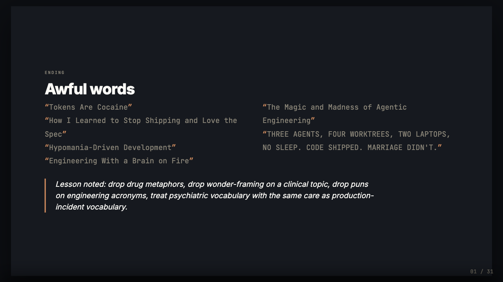
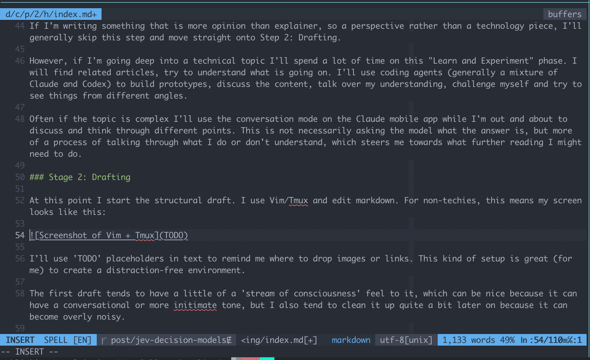

For a large part of 2025 I thought that AI could have a terrible impact on writers, especially those who write to explain or teach. Why bother writing rather than just asking someone to "Ask Claude"?

The tsunami of poor quality AI-assisted writing (or entirely AI generated writing) actually seems to have created quite a counter-effect, which is that a lot of people seem to appreciate human writing more than ever. This page briefly explains how I use AI when writing, in case anyone is curious or wondering whether everything is just a one-shot ChatGPT session.

## Why Write

It's fun. I've always loved reading and then discovered I also loved writing. I started publishing on [The CodeProject](https://web.archive.org/web/2024/https://www.codeproject.com/) (which sadly closed quite a few years ago, perhaps due to the popularity of Stack Overflow and then GitHub) from around the age of 12. I think what I particularly enjoyed was the fact that to write about a topic, you have to learn about it. Explaining how a technical concept works requires that you understand it at a level of depth to be able to contextualise it and think about it from the point of view of someone who _doesn't_ understand it. Essentially, you have to become deep enough to be a teacher. This is a great motivator to learn, and the satisfaction of taking a complex topic and presenting it with clarity is very high, a little bit like taking a complex maths problem and simplifying it into a short equation.

Writing is fantastic as a trigger for learning, but it is also fun just to share the cool discoveries you have made. My book [Effective Shell](https://effective-shell.com) was written not because I wanted to make money (unless extremely popular, most technical books produce very little income) but because all of the tricks and techniques people had shared over the years were just _fun_ to try out and integrate into a workflow.

As a [consultant](https://linkedin.com/in/dwmkerr) a large part of my role also involves contextualising. What does a particular technical topic actually mean for a given domain? Is it relevant? Will it change a business or disrupt a product? Should we spend time developing expertise? A lot is published on 'what' something is, but many people need to know 'what does it mean for me?'.

## How I use AI

The tldr is that I hand-write prose and use AI for learning, referencing, critiquing and visualisation. AI is almost frighteningly good at code, but can be truly terrible at prose[^editor], and most people don't need published AI output (if they want it, they can just ask AI), they are interested in human perspective or contextualisation. A fun example of how terrible AI output can be I put at the end of my conference presentation on AI and Bipolar disorder (where the AI suggested titles were so awful that I just had to include them at the end for fun):

*The titles AI suggested for the talk - [watch this part of the presentation](https://www.youtube.com/watch?v=ACL7_EsfIio&t=1435s).*

So even though I write prose almost entirely by hand, even some very short articles might have involved hours and hours of work with various models. This is how the process will typically look.

### Stage 1: Learning and Experimenting

If I'm writing something that is more opinion than explainer, so a perspective rather than a technology piece, I'll generally skip this step and move straight onto Stage 2: Drafting.

However, if I'm going deep into a technical topic I'll spend a lot of time on this "Learn and Experiment" phase. I will find related articles, try to understand what is going on. I'll use coding agents (generally a mixture of Claude and Codex) to build prototypes, discuss the content, talk over my understanding, challenge myself and try to see things from different angles.

Often if the topic is complex I'll use the conversation mode on the Claude mobile app while I'm out and about to discuss and think through different points. This is not necessarily asking the model what the answer is, but more of a process of talking through what I do or don't understand, which steers me towards what further reading I might need to do.

### Stage 2: Drafting

At this point I start the structural draft. I use Vim/Tmux and edit markdown. For non-techies, this means my screen looks like this:

I'll use 'TODO' placeholders in text to remind me where to drop images or links. This kind of setup is great (for me) to create a distraction-free environment.

The first draft tends to have a little of a 'stream of consciousness' feel to it, which can be nice because it can have a conversational or more intimate tone, but I also tend to clean it up quite a bit later on because it can become overly noisy.

If I'm improving or editing something already published, I tend to use Obsidian with Vim-mode to edit the text, so that I'm seeing something that looks more like the published version rather than the raw text.

### Stage 3: Illustrating

Really good visuals are absolutely critical to explaining concepts. I love how one well-crafted diagram or visualisation that you can interact with can bring it all together.

This is where I use AI extremely heavily. Generally the process will be:

1. Talk over what I am trying to express with a model like Fable. Have a long discussion.
2. Then ask for many, many iterations on how this could look, from different angles.
3. Then pick the ones that are looking like they're good candidates, and iterate.
4. Finally apply the appropriate visual styles (for example, for my blog or the style of a project).

This can take many hours. For example, the side-by-side comparison of LLMs vs Decision models below (from my [Jev article](../understanding-jev-decision-models/)):

  <iframe class="jev-embed" src="../visuals/llm-vs-decision-model.html" loading="lazy" title="An LLM and a decision model answering the same questions side by side" style="display:block;width:100%;height:1000px;border:0"></iframe>

Was the result of more than 50 iterations and a couple of accumulated hours of concentration (you can see what this journey looked like in [this page](../visuals/making-a-visual.html), which shows early to late iterations).

This tends to follow a 'Divergent then Convergent' process - start with many ideas and be open minded and explore, then as you get closer to what you want, narrow down and improve and fine-tune.

I will always create all of the text for visuals, as AI headings / descriptions / captions / whatever tend to not be very clear and use unnecessarily catchy idioms (and the text is as important as the image itself).

### Stage 4: Editing

At this point I'll read through the text and try to see if it makes sense. I'll ask multiple models to do the same and critique - for example, have I expressed something as a fact if it is really just an opinion.

I will also have my coding agents use Playwright to open the content in a browser, take screenshots, check layout for mobile and so on.

### Stage 5: Publishing

After the refinements are done, I'll share the article. I use AI here quite a bit - generally to create something like a screenshot or social media image with some of the points, to have a better asset to share with. I keep the text I share on social media or technical forums short and hand-written but will often use an AI generated gif or something for the visual hook.

If there is content that is AI generated that the reader might think I am presenting as hand-written, then I will be very clear as soon as possible. For example in the page I made showing the end to end process of creating a visual (which is basically a session log), I lead with:

_FYI: I had Claude create this page for me based on the session history from a long conversation on decision models. The lead/summary for each section is generated. This page basically just exists to illustrate what the process can look like._

### That's It

I have an ['editor'](https://github.com/dwmkerr/editor) project that I've built over time to de-noise AI text, but I use this for things like technical documentation (which I am happy to have produced by AI, as long as it is terse and clear).

As well as hand-writing articles, I almost always write and edit all of the README.md files in my projects.

[^editor]: See my [editor](https://github.com/dwmkerr/editor) project, which documents the most egregious idioms I have seen.
