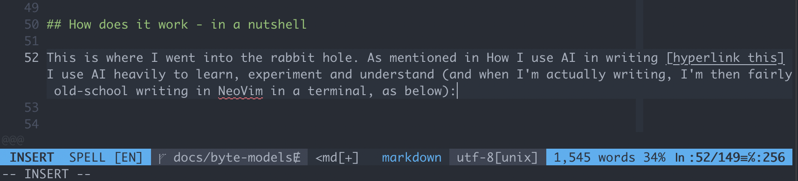
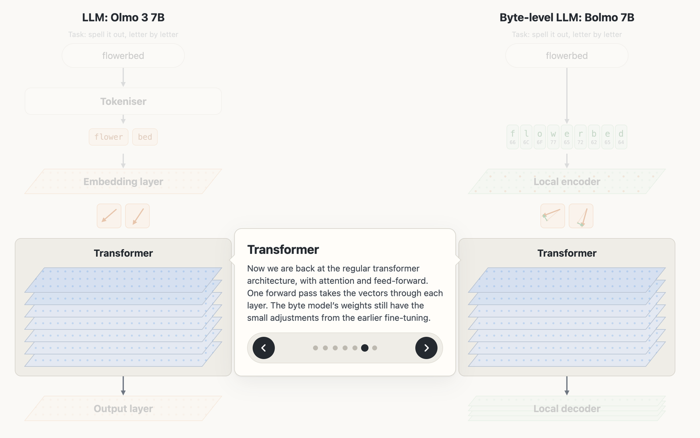

I have had some interesting learnings from paper "[Retrofitting language models to operate over bytes](https://doi.org/10.1038/s41586-026-11111-4)" (Nature, 2026; also on [arXiv](https://arxiv.org/abs/2512.15586)). In this write-up I'm going to explain how byte-level models work (which will likely be obvious to some) but also how the described technique differs - which is far more interesting as it allows you to add byte-level precision _to an existing model with an extremely low cost fine-tuning process_ rather than training a new one from scratch which is pretty fascinating and might have some implications in the STEM space.

A step-by-step visual of how training a byte model and generating output works is below - hopefully by the end of the article the process and implications will make sense:

  <iframe class="byte-embed" src="../visuals/olmo-vs-bolmo.html" loading="lazy" title="Olmo 3 and Bolmo side by side: how a byte-level model is trained from a regular LLM, step by step" style="display:block;width:100%;height:900px;border:0"></iframe>

*Visual built with AI, writing by hand ([how I use AI in writing](/how-i-use-ai-in-writing/)).*

## What are Byte Models?

Most commonly used large language models break up user input into 'tokens'. Tokens are essentially small fragments of words, these fragments are all the model sees. It is important to fragment words like this because a vocabulary of whole words would be enormous (and would still miss names, typos and new words), whereas a much smaller vocabulary of fragments can be combined to build any word.

This table shows a few examples:

| Text | Olmo 3 tokens | Bytes (UTF-8) |
|---|---|---|
| strawberry | `_strawberry` | `s` `t` `r` `a` `w` `b` `e` `r` `r` `y` |
| flowerbed | `_flower` `bed` | `f` `l` `o` `w` `e` `r` `b` `e` `d` |
| GB82WEST12345698765432 (this is a banking IBAN number) | `_GB` `82` `WEST` `123` `456` `987` `654` `32` | `G` `B` `8` `2` `W` `E` `S` `T` `1` `2` `3` `4` `5` `6` `9` `8` `7` `6` `5` `4` `3` `2` |
| café | `_café` | `c` `a` `f` `C3` `A9` |
| 草莓 ("strawberry" in Chinese) | `[E8 8D]` `[89]` `[E8]` `[8E]` `[93]` | `E8` `8D` `89` `E8` `8E` `93` |
| 🍓 | `[F0 9F]` `[8D]` `[93]` | `F0` `9F` `8D` `93` |

Breaking words up makes sense, but also raises a question - why not just break up into the individual characters, so we get even more precision and nuance? The bytes column in the table above shows what breaking up by letter would look like.

The reason is a trade-off. A byte-level vocabulary is tiny - only 256 possible values - but every piece of text becomes a much longer sequence (roughly 4-5x longer than with fragments), and every item in the sequence costs a step through the model. Byte-level models have been shown to compete well with token models of the same size[^prior], but they have always been trained from scratch, and the frontier labs have put their (vast) training budgets into token models instead. Many different tokenising schemes exist (you can read more about them on [Wikipedia](https://en.wikipedia.org/wiki/Large_language_model#Tokenization)).

A byte model is a model where the input is the raw bytes of the text (UTF-8), so there are only 256 possible values. Accented and non-English characters are made of more than one byte (`é` is two bytes, most emoji are four). With no fixed vocabulary of words, byte models can give more precision and nuance to characters. But if byte models are so costly to train, why bother?

## Why byte-tokenise

The paper explains a number of scenarios where byte level tokenisation can improve the quality of output, in particular:

- Non-English Languages which have not been trained as thoroughly
- Languages and input where there are many accents or more nuance at the character level
- Complex letter-level work where rearranging characters or more fine-grained semantics are needed

So there are benefits, but again, the cost is higher. However, the meat of this paper is some clever data science that actually gets around the cost limitations and essentially allows you to run a cheaper training run that adds a small step before inference, and after, that can add the nuance of byte-level tokenisation _to an existing model_.

This in itself is a very exciting pattern - the idea that you can take an existing model, such as one that you have painstakingly already trained on certain data, and then add precision to it at low cost.

What really caught my attention from the Nature article was this result:

**Bolmo 7B scored 16.5 points higher than the previous best byte model (BLT 7B) on STEM tasks, while keeping roughly the same scores as the original Olmo.**

That suggests byte-level precision doesn't have to cost you general capability, which is what makes it worth exploring for scientific work.

We do a lot of work in STEM at QuantumBlack, looking at models based on chemicals, DNA and scientific use cases, where specialised models are trained to build chemical pathways, protein sequences and other output in very specific 'languages'. A low cost way to add byte-level precision to models like these, without losing what they already do well, could be extraordinarily useful to investigate further.

## How it works

This is where I went down the rabbit hole. As mentioned in [How I use AI in writing](/how-i-use-ai-in-writing/) I use AI heavily to learn, experiment and understand (and when I'm actually writing, I'm then fairly old-school writing in NeoVim in a terminal, as below):

*Even more meta: writing this post in vim*

The area I was struggling with was this:

> If this pattern supposedly allows you to get more fine-grained nuance from an existing model, by adding a step before tokenisation, how does this process work when the existing model itself doesn't have byte level tokens? How can some kind of pre-inference step add detail, even if there is a step after the forward passes are done, when in the middle of the process we have the existing LLM?

A byte-ified model still goes through a regular transformer stage, using embeddings generated from tokens - so how can we preserve or recover any byte-level nuance?

*Byte-level models add a stage before and after the transformer; the transformer receives patch vectors that behave like the original embeddings.*

**The trick (and my misunderstanding)**

The trick was rooted in where I had a misunderstanding. This is not a tokenisation question - it is a modification at the _vectorisation_ stage. The embedding layer turns tokens into vectors. There are many more vectors in space than there are tokens. The byte-level logic just nudges the vectors around. The LLM transforms the nudged vectors. So of course, the LLM itself still contains the nuanced semantics at many levels of detail beyond tokens. The (very small) fine-tuning stage adds the byte-level nuance.

Here's the step by step visual again, with a short description below:

  <iframe class="byte-embed" src="../visuals/olmo-vs-bolmo.html" loading="lazy" title="Olmo 3 and Bolmo side by side: how a byte-level model is trained from a regular LLM, step by step" style="display:block;width:100%;height:900px;border:0"></iframe>

*Visual built with AI, writing by hand ([how I use AI in writing](/how-i-use-ai-in-writing/)).*

1. **Starting with an LLM**: We start with a regular LLM. The paper uses Olmo 3 7B, which has a regular LLM architecture.
2. **Training (stage 1)**: Olmo's transformer weights are locked, and a new encoder and decoder are trained around them to behave like Olmo[^stage1]. The encoder turns bytes into 'patches' that work like tokens; the decoder turns the output back into bytes.
3. **Training (stage 2)**: The lock comes off and the encoder, transformer and decoder are all fine-tuned together. Both stages used under 1% of the data Olmo was originally trained on.
4. **Tokens and bytes**: Olmo's tokeniser splits the text into tokens, from a vocabulary of about 100K. Bolmo uses the UTF-8 bytes directly, a vocabulary of just 256 values.
5. **Embedding**: Olmo looks up one vector per token. Bolmo's encoder groups the bytes into patches, looking one byte ahead, and turns each patch into one vector[^embeddings]. It is very similar to Olmo's, with a small adjustment that can carry extra nuance from the bytes.
6. **Transformer**: Back to the regular transformer, with attention and feed-forward layers. The byte model's weights carry the small adjustments from fine-tuning.
7. **Output**: Olmo's output layer picks the next token. Bolmo's decoder writes the patch out one byte at a time and decides where it ends, then the transformer runs again. Here Olmo drops the "w"; Bolmo spells it correctly.

Getting very hands on with code left me with a better sense of how LLMs work (and will be updating [LLMs Visualised](https://dwmkerr.github.io/llms-visualised/)).

The technique is cool, potentially applicable in other ways, and I'll shortly talk about the practical implications and whether you might want to investigate on your own or with your team. However, along the way I had a fun experience:

I was able to get a frontier model, Opus 5.5, to struggle with a spelling task with the word "Flowerbed". This is actually really really hard to do - frontier models are nowadays extremely good at this. It was not that long ago that [people were discussing how LLMs can't spell words](https://techcrunch.com/2024/08/27/why-ai-cant-spell-strawberry/)[^strawberry].

## Opus 5.5 vs "Flowerbed"

So along the way, I was asking for examples of when a byte model would out-perform a regular LLM. To my surprise, and unbridled joy, while Claude was explaining, it made a mistake with the spelling of flowerbed real-time:

  <iframe class="slip-embed" src="../visuals/flowerbed-slip.html" loading="lazy" title="A regular model and a byte model reversing &quot;flowerbed&quot;, with Opus marking the correct answer wrong and then correcting itself" style="display:block;width:100%;height:500px;border:0"></iframe>

*Opus 5.5 marks "debrewolf" as wrong, then spells it out letter by letter and finds it was right all along ([original screenshot](images/flowerbed-slip.png)).*

In this screenshot Claude is showing two rows - what a regular model might answer (meant to be a deliberately wrong reversal), and what a byte model might answer (the correct reversal). The mistake is in the first row: "debrewolf" is the _correct_ reversal, but it is marked ❌ as wrong.

I was delighted, as per these messages:

> **Me:** Hold on did you, Claude, actually make the mistake with flowerbed and then self correct? Was that an actual frontier LLM generation error?
>
> **Me:** Your longer, chatty answers, deliberate so that you have more opportunity for attention to catch mistakes?
>
> **Me:** Covered by reasoning?? Can I trust you any more my love???

Models are statistical constructs, given the training data when the words "spell backwards" and "flowerbed" are in the input, an output might be more likely to generate "debrewolf" than a _misspelled_ version.

This mistake was itself somewhat representative of the kind of error that byte-level tokenisation (or vector adjustment) could mitigate. The paper even uses flowerbed as its own example ([section 3.1.1](https://arxiv.org/html/2512.15586)): a boundary predictor could make `flowerbed` one patch, or split after the "r" to get `flower`. However, frontier models have quite a few techniques they can use to catch issues like this:

1. **Long, chatty answers give more opportunity for correction** - each forward pass gives opportunity to catch mistakes, and attention to earlier output means everything already written steers what comes next.
2. **A repeated word with contradicting labels is an easy hook for attention** - when Claude started the second row it was about to write "debrewolf" again, this time next to a ✅ rather than a ❌. Spotting an identical word is easy for attention (the same tokens appear twice), and the conflicting marks made the clash obvious.
3. **Reasoning is the structural solution** - this is fairly obvious - if the model uses reasoning then it'll generally pick up on the fact it needs to do character level processing and then check letter by letter, or use a tool (e.g. `rev <<< flowerbed` - shameless plug that shell tricks like this are in [my book which I think Claude ate](https://amzn.to/4ho0F91)). In this case reasoning didn't happen: the correction was made in the visible answer, not in the model's hidden "thinking" before it answered.
4. **Spelling out words with clearer letter-markers** - writing `f-l-o-w-e-r-b-e-d` can give clearer signals than the raw word `flowerbed`.

## Should you care?

The kinds of use cases that might jump to mind with a casual glance could be scenarios where you really need character-level precision, such as checking IBAN numbers, invoice numbers, code fragments and so on.

But the reality is that in most of these cases, you are not going to rely on raw LLM output - you are going to identify the consequential character-level work and process it with a tool call (so running an agent loop rather than just inference).

**But the exciting areas to explore are SLMs, STEM and non-English text**

Whilst you are unlikely to improve the output of large models, frontier models and so on, it is possible that if you have trained your own SLM (Small Language Model) and you want to get extra precision and nuance at byte level, during inference rather than with reasoning, then it might be worth exploring.

SLMs are by definition much smaller than LLMs - fewer parameters means less precision (in a general sense, in practice they are normally trained for a specific use case which they will have enough density to cover well and cheaply).

Non-English text processing might also be improved.

I also ran a short experiment of my own[^spelling]:

Using the small (1B) versions of both models, the same prompt that ends `Spell: cat -> c a t, flowerbed ->`, and no randomness in the output:

| Model | Output |
|---|---|
| OLMo 2 1B (regular LLM) | `f l o r e b e d` |
| Bolmo 1B (byte-level) | `f l o w e r b e d` |

The token model drops the "w" - it sees `flower` and `bed`, not the letters inside them. The byte model reads every letter, so it can simply copy them out. This is the same example used in the visual above.

I also asked Opus itself for a deliberately wrong reversal, 75 times over. Without reasoning it accidentally wrote the correct answer on 13 of 33 attempts; with reasoning, on just 1 of 42. A few of the slips:

| Word | Opus wrote | Correct | Caught? |
|---|---|---|---|
| banana | `ananab`, then "wait, that's actually correct. A wrong answer: ananb" | ananab | Yes, mid-answer |
| eyelet | "Correct: telege. Plausible wrong: teleye" | teleye | No: its "correct" answer was wrong, so its "wrong" one was right |
| serendipity | `ytipidneres` | ytipidneres | No |
| tennessee | `eessennet` | eessennet | No, the only slip with reasoning |

When asked to check its answers afterwards, Opus spotted every one of the uncaught slips.

Thanks for reading, please subscribe if you found this kind of material useful.

## Further Reading

- The paper: [Retrofitting language models to operate over bytes](https://doi.org/10.1038/s41586-026-11111-4) (Nature, 2026)
- The preprint: [arXiv 2512.15586](https://arxiv.org/abs/2512.15586)
- The Ai2 blog post: [Bolmo](https://allenai.org/blog/bolmo)
- Open weights: [Bolmo 7B](https://huggingface.co/allenai/Bolmo-7B) and [Bolmo 1B](https://huggingface.co/allenai/Bolmo-1B)
- The same method was also applied to Llama and Qwen (Blama 8B and Bwen 8B in the paper)

[^writing]: Including [How I use AI in writing](/how-i-use-ai-in-writing/), which has been a little meta.

[^strawberry]: They can't - models don't see letters - but modern reasoning models have many techniques to handle spelling challenges.

[^prior]: Earlier byte models include BLT and H-Net. Bolmo 7B, from this paper, beats BLT 7B by 16.5 points on STEM tasks.

[^stage1]: Stage 1 matches Olmo in two ways: the encoder is trained so its patch vectors produce the same internal state as Olmo's embeddings after the first four transformer layers, and the decoder is trained so each patch gets the same likelihood Olmo gave the matching token.

[^embeddings]: Olmo's embeddings are not fully thrown away: Bolmo keeps Olmo's embedding table as a helper inside the local encoder, adding the embedding of the longest vocabulary entry ending at each byte. Olmo's output layer is not reused.

[^spelling]: Bolmo's training mix included spelling-style exercises (paper, Appendix C), but the paper shows it still beats an Olmo trained on the same mix for the same number of tokens.
